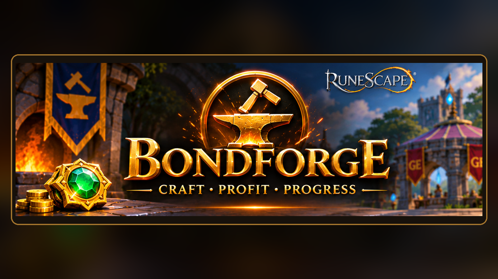

# BondForge

**Craft • Profit • Progress**

BondForge is a RuneScape 3 plugin for estimating crafting profits and tracking progress toward a Bond.

## Features

- Automatic official Grand Exchange guide prices for the selected product and Bonds (optional HTTP access)
- Manual item price, Bond price and material cost entry
- Estimated per-item profit including a 2% Grand Exchange fee estimate
- Inventory-based production counts and review of large inventory increases
- Estimated GP earned, Bond goal progress, milestones and remaining items
- Session production statistics, estimated GP/hour and completion ETA
- Compact and expanded interfaces, with saved preferences and progress

## Important limitations

All prices, profits, GP/hour and ETA figures are **estimates**, not verified sales. Inventory increases may result from banking or trading rather than crafting. Some date-dependent statistics may be unavailable in the RuneScape plugin runtime.

## Installation

Install through the official RuneScape Plugin Hub when available. This repository contains the source files for version **0.2.0**; the Mod.io submission may still be pending review.

For development installations, keep the internal plugin folder identifier `MembershipGoalAutoPrice` to preserve existing settings and permissions. Reload with `plugins_reload MembershipGoalAutoPrice`.

## Permissions and data

The plugin requests optional `httpAccess` to obtain public price information from `services.runescape.com` (with RuneScape Wiki fallback). Manual pricing works without HTTP access. The plugin does not need chat or tracking permissions. Its persistent settings and estimated progress are stored through the plugin's local settings facilities.

## Support

Open a GitHub Issue for bug reports and feature requests, or contact `milkdudz21@gmail.com`.

## Version

Current release candidate: **v0.2.0 RC2**. The Reset Progress callback error has been fixed and tested in-game.

## Licence

No open-source licence has been selected yet. Do not assume permission to redistribute or modify the code. RuneScape and related marks belong to their respective owners. This project is not endorsed by Jagex.
